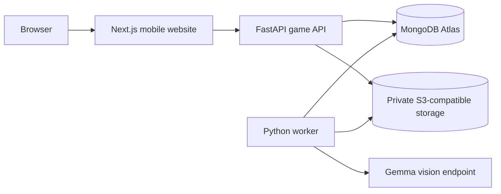

# Wildmon

Wildmon is a mobile-first nature discovery game. Photograph one living thing, let a vision-capable open-weight Gemma model inspect it, and build a collection from verified results. Timed hunts, friend challenges, ecosystem checklists, badges, and XP make exploring together playful without keeping the phone in hand.

This is an implementation in progress. See [IMPLEMENTATION_STATUS.md](IMPLEMENTATION_STATUS.md) for what has actually been tested.

## Architecture



FastAPI owns authentication, eligibility, matching, XP, challenge timing, timed ecosystem attempts, and leaderboards. Next.js handles the web experience and proxies `/api/v1` to FastAPI so browser cookies stay on one origin. The worker claims durable MongoDB jobs for inference and closes challenges and ecosystems even when browsers are closed. LangChain composes prompt construction and model transport. AI Studio Gemma uses Google's native `generateContent` API; other OpenAI-compatible model hosts use the alternate adapter. Results are validated with Pydantic and resolved against a curated catalog before any exact-species award.

The interface follows the [Geist design system reference](https://vercel.com/geist/introduction) for clear typography, high-contrast surfaces, and disciplined spacing. It uses the Geist font, Tailwind CSS, and Radix primitives with a Wildmon forest and butterfly palette. The official Geist documentation is a design reference here, not an installed Vercel component package.

## Local setup

Requirements: pnpm, uv, Python 3.12+, MongoDB Atlas or local MongoDB, and an endpoint serving a **vision-capable Gemma** model. Google documents [Gemma 4 on the Gemini API](https://ai.google.dev/gemma/docs/core/gemma_on_gemini_api); choose a model your account actually serves and evaluate it before enabling exact species.

Run each setup block from the repository root.

1. Install frontend packages:

   ```bash
   pnpm install
   cp apps/web/.env.example apps/web/.env.local
   ```

2. Install backend packages and configure secrets:

   ```bash
   (cd apps/api && uv sync && { test -f .env || cp .env.example .env; })
   ```

   Edit `apps/api/.env` with `MONGODB_URI`, a random `JWT_SECRET`, `GEMMA_BASE_URL`, `GEMMA_API_KEY`, and `GEMMA_MODEL`. Set `BACKBOARD_KEY` to fall back through Backboard when a Google Gemma call fails. The fallback sends the same prepared image to the same Gemma model through Backboard's vision message API; it may incur Backboard charges. Do not commit secrets. Use `STORAGE_MODE=local` for development. For production use a private S3-compatible bucket and fill the `S3_*` settings. `apps/web/.env.local` only needs `API_PROXY_TARGET` when the API is not at `http://localhost:8000`.

   VS Code settings point Pylance at `apps/api/.venv` when the repository root is open, and at `.venv` when `apps/api` is open directly. If VS Code previously cached another interpreter, run **Python: Select Interpreter** and choose `apps/api/.venv/bin/python` (or `.venv/bin/python` from the API folder), then reload the window.

3. Seed indexes and provisional catalog:

   ```bash
   (cd apps/api && uv run python -m scripts.probe_services)
   (cd apps/api && uv run python -m scripts.seed)
   ```

   The probe checks Atlas and a real Gemma image call without printing keys. Its bundled image is synthetic and does not count toward model evaluation.

   If the AI Studio connection fails, run the focused credential check from your own terminal:

   ```bash
   cd apps/api && uv run python -m scripts.check_gemma_credentials --vision
   ```

   It checks key access, the configured model, text generation, and an image request in that order. It prints Google's bounded error message with the key redacted and distinguishes connection, upload, and response timeouts. Generation waits up to 120 seconds by default; use `--timeout 180` for a longer check. Omit `--vision` to skip the image request.

   For a fast image-only comparison on another supported Gemma model, run `uv run python -m scripts.check_gemma_credentials --vision-only --model gemma-4-26b-a4b-it` from `apps/api`. This override tests the model without changing `.env`.

   After switching `GEMMA_MODEL` to a model that passes the image check and restarting the worker, restore submissions that exhausted retries on Google HTTP 500 with `uv run python -m scripts.requeue_gemma_500 --apply` from `apps/api`. Run without `--apply` first to see the eligible count.

   The worker's model read timeout defaults to 120 seconds via `GEMMA_TIMEOUT_SECONDS`; increase it in `apps/api/.env` only if real image calls need longer. Restart the worker after changing this setting.

4. Run these in separate terminals:

   ```bash
   cd apps/api && uv run uvicorn app.main:app --reload --port 8000
   cd apps/api && uv run python -m app.worker
   pnpm dev:web
   ```

Open the website at `http://localhost:3000`; API health is at `http://localhost:8000/api/v1/health`, API docs at `http://localhost:8000/docs`. Browser requests use the website's `/api/v1` proxy, including private image URLs and local-development uploads.

Timed free hunts can award +25, +60, or +100 estimated in-app focus XP after at least one verified discovery. The browser records app-hidden and visible-again events, and the server counts only paired intervals after capture/finish allowances. It cannot prove the phone screen was physically off. The worker completes hunts and reconciles focus XP even when the summary is closed; a visible-again event may arrive up to two minutes after the deadline. Keep the worker running. Quick captures have no focus bonus.

For testing from another device on your LAN, open `http://<computer-ip>:3000` and set `WEB_ORIGIN=http://<computer-ip>:3000` in `apps/api/.env`. Next.js still proxies API requests to `http://127.0.0.1:8000` on the computer, so the phone never needs to reach its own `localhost`. If the computer's LAN IP changes, update `allowedDevOrigins` in `apps/web/next.config.ts` and restart both development servers after changing these settings.

To generate frontend OpenAPI types after dependency installation:

```bash
cd apps/api && uv run python -m scripts.export_openapi
cd ../web && pnpm typegen
```

The generated types are checked in at `apps/web/src/lib/api-types.ts`. Some frontend view models remain hand-maintained because their FastAPI response schemas still need to be declared.

## Deploy: Render API and worker, Vercel web

`render.yaml` is a reviewable Blueprint, not a deployed service. It defines a FastAPI web service and a **paid, continuously running background worker**. Both use `apps/api` as their root directory, install the locked Python dependencies, and run on Python 3.12. The API seeds indexes and the provisional catalog at startup. It does **not** deploy Next.js.

1. Prepare MongoDB Atlas, a private S3-compatible bucket, and a working vision-capable Gemma endpoint. **Cloudflare R2 Standard** is a storage option with a [monthly free allowance](https://developers.cloudflare.com/r2/pricing/); it uses the S3 API, so the app needs no new storage adapter. Cloudflare requires an R2 subscription checkout, and usage above the free allowance is billed. Create a private R2 bucket and an Object Read & Write API token scoped to that bucket, then copy its Access Key ID, Secret Access Key, and account endpoint (`https://<ACCOUNT_ID>.r2.cloudflarestorage.com`). Use `S3_REGION=auto` for R2. Set bucket CORS to allow browser `PUT` requests from the final Vercel website origin with the `Content-Type` header. The API and worker must use the same Atlas database and bucket. Render's local filesystem is ephemeral and cannot be shared between services. See Cloudflare's [S3 setup](https://developers.cloudflare.com/r2/get-started/s3/) and [CORS guide](https://developers.cloudflare.com/r2/buckets/cors/).
2. Push this repository to GitHub. In Render, choose **New → Blueprint**, connect the repository, and select `render.yaml`. Review the worker's paid plan before applying. Fill in the prompted `MONGODB_URI`, `WEB_ORIGIN`, `S3_BUCKET`, `S3_ENDPOINT_URL`, `S3_ACCESS_KEY_ID`, `S3_SECRET_ACCESS_KEY`, and `GEMMA_API_KEY`. `WEB_ORIGIN` is the final Vercel URL, for example `https://wildmon.vercel.app`, with no trailing slash. The Blueprint sets `S3_REGION=auto` for R2; if using AWS S3 or another provider, set its required region and endpoint instead. `BACKBOARD_KEY` is optional; if unused, leave it empty. The Blueprint generates `JWT_SECRET` and copies the shared API settings to the worker.
3. Add **both** Render services' outbound IP ranges to Atlas Network Access. Wait for the API and worker to deploy. Check `https://<your-api>.onrender.com/api/v1/health` for `database: connected` and check the worker logs for its database connection. The API may cold start on the free plan; the paid worker stays active for inference and deadlines.
4. In Vercel, import the same GitHub repository as one **Next.js** project and set **Root Directory** to `apps/web`. Set `API_PROXY_TARGET` to the Render API origin, for example `https://<your-api>.onrender.com`, with no trailing slash or `/api/v1`. Deploy the website. Browser requests to `/api/v1/*` are proxied by Next.js to Render, so login cookies stay on the Vercel origin. The root `.vercelignore` excludes backend and local tooling from Vercel uploads; it does not control which Render services deploy.
5. Once the production Vercel URL is known, confirm that Render's `WEB_ORIGIN` and the bucket's CORS origin match it exactly. If either changes, update it and redeploy/restart the affected service. Test `https://<your-web>.vercel.app/api/v1/health`, then registration and one photo upload. For Vercel preview deployments on different domains, this single-origin setting and bucket CORS need additional configuration; use the production domain for the first deployment.

Do not put Atlas, S3, JWT, or Gemma secrets in Vercel environment variables. Vercel only needs the public API origin in its server-side `API_PROXY_TARGET` setting. Render's [Blueprint guide](https://render.com/docs/infrastructure-as-code), [background worker docs](https://render.com/docs/background-workers), [free service limits](https://render.com/docs/free), and [Atlas guide](https://render.com/docs/connect-to-mongodb-atlas) cover the provider setup.

## Model evaluation

Species in the seed catalog start with `supported: false`. The app can show category-level results, but exact-species challenge targets remain unavailable until supported species are deliberately enabled after evaluation.

Prepare at least 30 labeled photos including plants, birds, insects, blurry or multi-subject images, and unrelated images. Use `apps/api/evaluation/manifest.example.jsonl` as the JSONL format. Then run:

```bash
cd apps/api
uv run python -m scripts.evaluate_model evaluation/manifest.jsonl --output model-evaluation.json
```

The report includes exact-species accuracy, category precision, false positives on negative images, abstention, and median/p95 latency. Review the per-photo output before changing any species document to `supported: true`. Model confidence text is not treated as calibrated probability. Rarity is not scored without cited regional data.

## Test and demo path

```bash
cd apps/api && uv run pytest
pnpm --filter web lint
pnpm --filter web build
```

Register two accounts, send and accept a friend request, take a quick capture, start and finish a timed hunt, create a category/trait challenge, start a timed ecosystem and submit photos through its dedicated capture, and view both leaderboard scopes. Exact-species challenge targets require the evaluation gate above. Keep the worker running for inference and deadlines.

Wildlife guidance: photograph without touching, feeding, picking, approaching nests, or entering unsafe or private locations. Images are private to the owner in the current API. Public sharing and account deletion are still outstanding.
