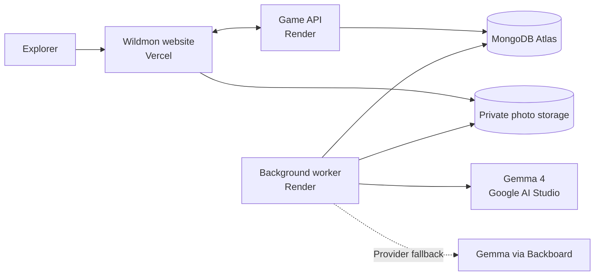

  
  <h1>Wildmon</h1>
  
<strong>Touch grass. Look closer.</strong>

  
A nature discovery game that turns a walk into a collection, a challenge, and a reason to keep looking around.

  

  

    
    
    
    
    
  

  

    <a href="https://wildmon.vercel.app/">Live app</a> ·
    <a href="#ways-to-explore">What you can do</a> ·
    <a href="#how-it-fits-together">Architecture</a> ·
    <a href="https://youtu.be/eyGy4yaowKo">Walkthrough</a> ·
    <a href="https://dev.to/pradeepa_17/wildmon-find-more-outside-493a">Article</a>
  

  

## The idea

A walk becomes more interesting when you have something to look for. Wildmon turns a photo of a plant, bird, or insect into a discovery you can revisit. You can follow your curiosity, choose an ecosystem to explore, or invite a friend to find the same targets.

The camera interaction is brief. Identification continues while you keep walking, and your findings are waiting when you return.

## Ways to explore

| Experience | What you do |
| --- | --- |
| **Discoveries** | Photograph something that catches your eye and build a collection of verified findings. |
| **Ecosystems** | Choose a timed nature checklist and make new discoveries for that challenge. |
| **Timed hunts** | Spend time outdoors, collect findings, and earn a focus bonus for eligible time away from Wildmon. |
| **Friend challenges** | Invite a friend, agree on targets, and start a shared clock when both players are ready. |
| **Rewards** | Follow your progress through XP, badges, and weekly or all-time leaderboards for the global community and your friends. |

Focus rewards estimate time away from Wildmon during a timed hunt. A website cannot verify that a phone's physical screen was off. Identification can also be uncertain; Wildmon shows that clearly and lets you retry a failed discovery.

## How it fits together

The website keeps capture and challenge screens simple. The API holds accounts, discoveries, and game progress. A separate worker identifies photos and settles timed activities, so the experience continues after you leave the page. Gemma 4 interprets images; Backboard provides another route to the same model when the primary request fails.

## Project guide

| Location | What you'll find |
| --- | --- |
| [`apps/web/`](apps/web/) | The website and mobile-friendly game screens. |
| [`apps/api/`](apps/api/) | The API, background worker, and model evaluation utilities. |
| `artifacts/` | Local walkthrough exports and captions. Watch the public video on [YouTube](https://youtu.be/eyGy4yaowKo). |
| `docs/` | The submitted article's local Markdown, screenshots, and upload bundle. |

Walkthrough exports and local editorial assets are kept out of the Git repository. The website, API, and worker are deployed separately on Vercel and Render.

## Take it outside

Try the [live app](https://wildmon.vercel.app/): take a photo of one clear organism, start an ecosystem for a longer outing, or challenge a friend to explore alongside you. Keep a safe distance from wildlife and leave plants, nests, and habitats undisturbed.
